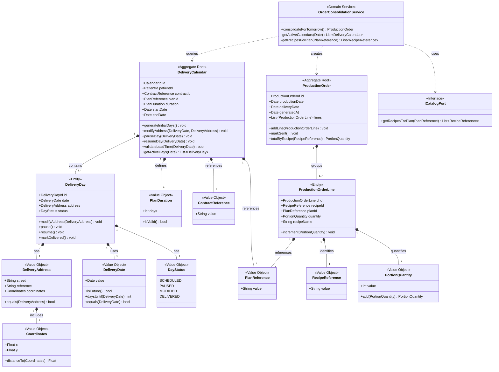

# nurtricenter-delivery-schedule — MS4

> **Bounded Context:** Delivery Schedule Management
> **Owner:** Franklin Andre Romero Padilla
> **Part of:** NutrCenter Microservices Architecture (Universidad NUR — Activity 1, v2)

---

## Table of Contents

1. [Business Context](#business-context)
2. [Responsibilities](#responsibilities)
3. [Ubiquitous Language](#ubiquitous-language)
4. [Domain Model](#domain-model)
   - [Aggregates](#aggregates)
   - [Entities](#entities)
   - [Value Objects](#value-objects)
   - [Domain Services](#domain-services)
   - [Ports (Anti-Corruption Layer)](#ports-anti-corruption-layer)
5. [Class Diagram](#class-diagram)
6. [Context Map — Upstream / Downstream](#context-map--upstream--downstream)
7. [User Stories](#user-stories)
8. [Business Rules](#business-rules)
9. [Project Structure (suggested)](#project-structure-suggested)

---

## Business Context

**NutrCenter** is a nutritional services company offering body evaluation, nutritional counseling, and personalized catering. When a patient contracts a catering plan (15 or 30 days), a delivery calendar is created for them. This microservice owns that calendar for its entire lifecycle.

The company prepares food **the day before delivery**. Because of this, the system must consolidate all active calendars each day and generate a `ProductionOrder` for the kitchen — containing the exact recipes and quantities to prepare for the next day's deliveries.

---

## Responsibilities

This service is responsible for:

- Receiving a contract notification from **MS3** and automatically generating the initial scheduled days (15 or 30).
- Allowing patients to modify their delivery address per day or pause specific days, enforcing a **2-day lead time** rule for any change.
- Exposing active calendars so the consolidation process can generate the daily `ProductionOrder`.
- Querying recipe data from **MS2** (via an outbound port) to calculate the quantities to be prepared.
- Sending the consolidated `ProductionOrder` to **MS3** for physical production.

**This service does NOT:**
- Handle patient clinical data (owned by MS1).
- Manage recipe or plan catalog definitions (owned by MS2).
- Handle packaging, labeling, or invoicing (owned by MS3).
- Handle delivery routing or proof of delivery (owned by MS5).

---

## Ubiquitous Language

| Term | Definition |
|---|---|
| `DeliveryCalendar` | The full schedule of delivery days assigned to a patient under a catering contract. |
| `DeliveryDay` | A single day within the calendar, with its own address and status. |
| `DeliveryAddress` | The physical location where the patient's package should be delivered on a given day. |
| `Coordinates` | A flat (x, y) coordinate pair used for simple proximity-based routing. |
| `DayStatus` | The current state of a delivery day: SCHEDULED, PAUSED, MODIFIED, or DELIVERED. |
| `PlanDuration` | The contracted duration of the catering plan: 15 or 30 days. |
| `ProductionOrder` | A daily consolidated list of recipes and quantities the kitchen must prepare. Generated for the next day (D-1). |
| `ProductionOrderLine` | A single recipe entry within a ProductionOrder, with its total portion count across all patients. |
| `Lead Time Rule` | Any change to a delivery day (address or pause) must be made at least 2 days in advance. |
| `ContractReference` | An external identifier referencing the contract created in MS3. |
| `PlanReference` | An external identifier referencing the meal plan defined in MS2. |
| `RecipeReference` | An external identifier referencing a recipe defined in MS2. |
| `PortionQuantity` | The number of portions of a given recipe to be prepared. |

---

## Domain Model

### Aggregates

#### `DeliveryCalendar` — Aggregate Root
The central aggregate of this context. Guards the **2-day lead time invariant**: no `DeliveryDay` can be modified or paused without the calendar first validating this rule. All access to individual days passes through the calendar.

#### `ProductionOrder` — Aggregate Root
Represents a daily production event with its own lifecycle (generated → sent). It aggregates data from multiple calendars and is consumed atomically by MS3. It is kept as a separate aggregate because its purpose is to consolidate across many `DeliveryCalendar` instances — a concern that does not belong to any single calendar.

---

### Entities

| Entity | Identity | Description |
|---|---|---|
| `DeliveryCalendar` | `CalendarId` | One per patient per contract. Lifecycle: active for 15 or 30 days. |
| `DeliveryDay` | `DeliveryDayId` | One entry per day within the calendar. Changes state over time. |
| `ProductionOrder` | `ProductionOrderId` | One per production date. Generated daily by the consolidation service. |
| `ProductionOrderLine` | `ProductionOrderLineId` | One per recipe within a production order. Quantities accumulate across patients. |

---

### Value Objects

| Value Object | Immutable | Description |
|---|---|---|
| `DeliveryAddress` | ✅ | Street, reference, and coordinates. Replaced entirely on change. |
| `Coordinates` | ✅ | Flat (x, y) pair. No identity; defined purely by its values. |
| `DeliveryDate` | ✅ | Domain-aware date wrapper. Knows if it is in the future and how many days remain. |
| `DayStatus` | ✅ | Enum: SCHEDULED, PAUSED, MODIFIED, DELIVERED. |
| `PlanDuration` | ✅ | 15 or 30 days. Validates that only these values are allowed. |
| `ContractReference` | ✅ | External ID from MS3. No local behavior. |
| `PlanReference` | ✅ | External ID from MS2. No local behavior. |
| `RecipeReference` | ✅ | External ID from MS2. No local behavior. |
| `PortionQuantity` | ✅ | Integer with domain semantics. Addition produces a new instance. |

---

### Domain Services

#### `OrderConsolidationService`
Coordinates the daily consolidation process. It does not belong to any single aggregate because it must:
1. Retrieve all active `DeliveryCalendar` instances for the next day.
2. Query MS2 via `ICatalogPort` to get the recipes for each plan.
3. Build and return a consolidated `ProductionOrder`.

---

### Ports (Anti-Corruption Layer)

#### `ICatalogPort` (outbound)
An interface defined in the domain layer. It protects this context from coupling to MS2's internal model. The infrastructure layer provides the concrete adapter (HTTP client, message consumer, etc.).

```
ICatalogPort
  └── getRecipesForPlan(PlanReference): List<RecipeReference>
```

---

## Class Diagram



---

## Context Map — Upstream / Downstream

```
MS3 · Contracting & Production  ──(upstream)──►  MS4 · Delivery Schedule
  Sends: contract notification (contractId, planId, patientId, duration)
  Trigger: patient signs a catering contract

MS4 · Delivery Schedule  ──(upstream)──►  MS3 · Contracting & Production
  Sends: consolidated ProductionOrder (recipes + quantities for D-1)
  Trigger: daily scheduled consolidation job

MS2 · Meal Catalog  ──(upstream)──►  MS4 · Delivery Schedule
  Provides: recipes per plan (via ICatalogPort)
  Trigger: during ProductionOrder consolidation
```

| Provider (Upstream) | Consumer (Downstream) | Data Exchanged |
|---|---|---|
| MS3 · Contracting | MS4 · Delivery Schedule | Contract notification triggering calendar creation |
| MS2 · Meal Catalog | MS4 · Delivery Schedule | Recipes and portions per plan (via port) |
| MS4 · Delivery Schedule | MS3 · Production | Consolidated ProductionOrder for the next day |

---

## User Stories

| # | Actor | Story | Acceptance Criteria |
|---|---|---|---|
| US-01 | System | Receive contract notification from MS3 and automatically generate the initial calendar days with status SCHEDULED based on plan duration (15 or 30 days). | Calendar has exactly `duration.days` entries starting from `startDate`. All days default to SCHEDULED. |
| US-02 | Patient | Define a delivery address per day (e.g., office on weekdays, home on weekends). | Each `DeliveryDay` holds its own `DeliveryAddress`. Different days can have different addresses. |
| US-03 | Patient | Modify the delivery address of a specific day. | Change is only accepted if made at least 2 days before the target date. Day status changes to MODIFIED. |
| US-04 | Patient | Pause a specific delivery day (travel, other reasons). | Change is only accepted if made at least 2 days before the target date. Day status changes to PAUSED. |
| US-05 | Patient | Resume a previously paused day. | Day reverts to SCHEDULED. Lead time rule applies. |
| US-06 | System | Consolidate all active calendars daily and generate a `ProductionOrder` for the next day. | `ProductionOrder.productionDate = today`, `ProductionOrder.deliveryDate = tomorrow`. Lines group all portions by recipe across all active patients. |

---

## Business Rules

| Rule | Description |
|---|---|
| **BR-01: Lead Time** | Any modification to a `DeliveryDay` (address change or pause) must be requested at least 2 calendar days before the target delivery date. Requests that violate this rule must be rejected with a domain exception. |
| **BR-02: Valid Duration** | `PlanDuration` only accepts values of 15 or 30. Any other value is invalid and must be rejected at construction time. |
| **BR-03: Production Dates** | `ProductionOrder.productionDate` is always D-1 relative to `deliveryDate`. The kitchen prepares food the day before delivery. |
| **BR-04: Calendar Ownership** | A `DeliveryCalendar` belongs to exactly one patient and one contract. A patient may have multiple calendars over time (sequential contracts) but only one active at a time per contract. |
| **BR-05: Paused Days** | Paused days are excluded from the `ProductionOrder` consolidation. No portions are generated for a PAUSED day. |
| **BR-06: External References** | `ContractReference`, `PlanReference`, and `RecipeReference` are treated as opaque identifiers. This context does not validate their existence — that responsibility belongs to the owning context. |

---

## Project Structure (suggested)

```
nurtricenter-delivery-schedule/
├── src/
│   ├── domain/
│   │   ├── model/
│   │   │   ├── calendar/
│   │   │   │   ├── DeliveryCalendar.ts
│   │   │   │   ├── DeliveryDay.ts
│   │   │   │   ├── DeliveryAddress.ts
│   │   │   │   ├── Coordinates.ts
│   │   │   │   ├── DeliveryDate.ts
│   │   │   │   ├── DayStatus.ts
│   │   │   │   ├── PlanDuration.ts
│   │   │   │   ├── ContractReference.ts
│   │   │   │   └── PlanReference.ts
│   │   │   └── production/
│   │   │       ├── ProductionOrder.ts
│   │   │       ├── ProductionOrderLine.ts
│   │   │       ├── RecipeReference.ts
│   │   │       └── PortionQuantity.ts
│   │   ├── service/
│   │   │   └── OrderConsolidationService.ts
│   │   └── port/
│   │       └── ICatalogPort.ts
│   ├── application/
│   │   └── use-cases/
│   │       ├── CreateCalendarUseCase.ts
│   │       ├── ModifyDeliveryAddressUseCase.ts
│   │       ├── PauseDeliveryDayUseCase.ts
│   │       ├── ResumeDeliveryDayUseCase.ts
│   │       └── ConsolidateProductionOrderUseCase.ts
│   └── infrastructure/
│       ├── persistence/
│       ├── adapters/
│       │   └── CatalogHttpAdapter.ts   ← implements ICatalogPort
│       └── http/
│           └── controllers/
├── test/
│   ├── domain/
│   └── application/
├── README.md
└── package.json
```

---

## Team

| Microservice | Context | Owner |
|---|---|---|
| MS1 · `nurtricenter-patient-care` | Clinical & Nutritional Management | Diego Cabrera Alvarez |
| MS2 · `nurtricenter-meal-catalog` | Meal Plan & Recipe Catalog | Robert Perez Lino |
| MS3 · `nurtricenter-contracting-production` | Contracting & Physical Production | Luis Jesús Ferrufino Burgos |
| **MS4 · `nurtricenter-delivery-schedule`** | **Delivery Schedule Management** | **Franklin Andre Romero Padilla** |
| MS5 · `nurtricenter-delivery-logistics` | Logistics & Delivery | Andres Sebastián Guerrero Camacho |

---

> Universidad NUR — Santa Cruz, Bolivia
> Course: Domain-Driven Design & Clean Architecture
> Instructor: Ing. Jose Carlos Gutiérrez